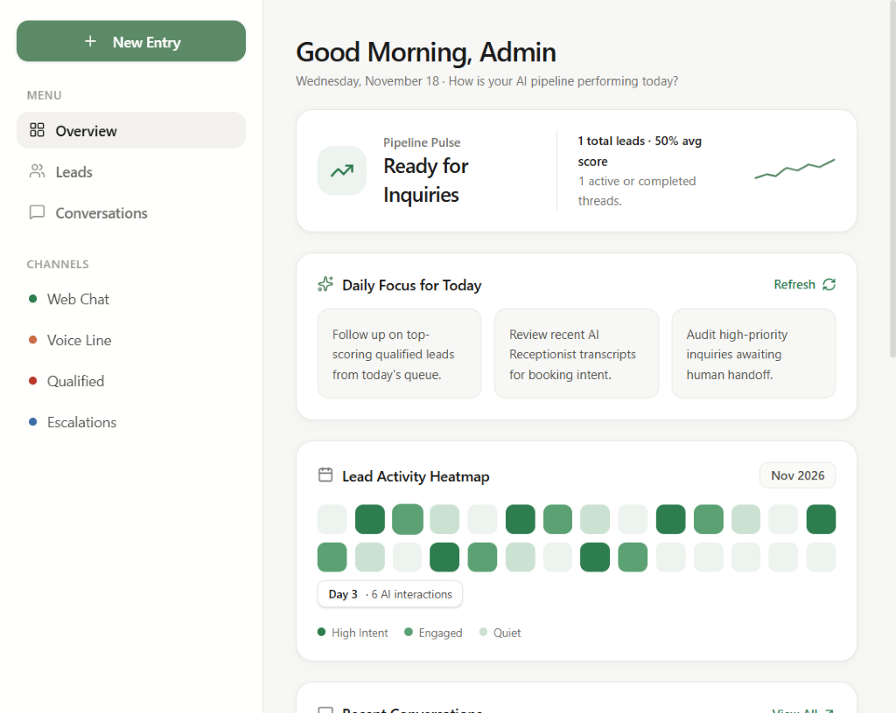
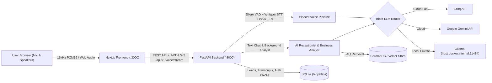

# AI Employee: Real-Time Voice Agent & CRM

[](https://www.python.org/)
[](https://fastapi.tiangolo.com/)
[](https://nextjs.org/)
[](https://www.docker.com/)
[](https://www.pipecat.ai/)

An end-to-end, Dockerized **Real-Time Voice AI Receptionist & Autonomous CRM** platform built with FastAPI, Pipecat, Next.js, SQLite, and a Triple-LLM router (**Groq**, **Google Gemini**, and **local Ollama**).

---

## Overview

**AI Employee** combines a low-latency bidirectional WebSocket/WebRTC voice receptionist, a bilingual (English & Bangla) RAG text chat assistant, and an automated **AI Business Analyst** inside a warm editorial CRM dashboard:

- **Real-Time Voice Receptionist:** Browser audio is captured and resampled to 16 kHz PCM16, analyzed via **Silero VAD** with barge-in interruption support, transcribed locally with **Faster-Whisper**, reasoned over via the **Triple-LLM Router**, and synthesized back in real time using **Piper TTS**.
- **Triple-LLM Routing (`groq` / `gemini` / `ollama`):** Switch seamlessly between ultra-fast Groq Cloud inference, Google Gemini, or 100% private local Ollama models with graceful fallbacks across voice, chat, lead scoring, and AI follow-up drafting.
- **Automated Lead Capture & Follow-Up:** After every chat or voice call, the `AIBusinessAnalyst` scores intent, updates lead priority/status in SQLite, and powers one-click **AI Lead Follow-Up** message drafting directly inside the Leads Pipeline.

---

## Dashboard Preview



---

## Architecture Diagram



---

## Key Features

- **Low-Latency Voice AI (`Pipecat`):** Bidirectional WebSocket audio streaming with Silero VAD speech segmentation, Faster-Whisper STT, Piper TTS, and automatic client-side 16 kHz downsampling.
- **RAG Knowledge Base (`LlamaIndex` + `ChromaDB`):** Answers store hours, pricing, refund policies, and escalation rules grounded strictly in `knowledge_base/` and `backend/rag/data/business_faq.md`.
- **Automated Call & Chat Analysis:** Background `AIBusinessAnalyst` produces structured JSON summaries, `0–100` lead scores, priority tags, and escalation alerts (`Needs Manual Review` fallback when offline).
- **AI Lead Follow-Up Modal:** Draft personalized, placeholder-free follow-up messages from lead history and score (`POST /api/v1/leads/{id}/draft-follow-up`) and persist sent messages (`POST /api/v1/leads/{id}/send-follow-up`).
- **Production Hardening & Auth:** HS256 JWT authentication with strict `exp` enforcement, `bcrypt` password hashing, SlowAPI rate limiting, SQLite WAL + foreign-key mode, and non-wildcard CORS.

---

## Quick Start (Docker)

### Prerequisites
- [Docker Desktop](https://www.docker.com/products/docker-desktop/) (or Docker Engine + Docker Compose v2)
- Optional: [Ollama](https://ollama.com/) running locally on port `11434` if using `LLM_PROVIDER=ollama`

### 1. Configure Environment Variables
Copy `.env.example` to `.env` in the repository root and add your API keys (`GROQ_API_KEY`, `GEMINI_API_KEY`, or configure `LLM_PROVIDER=ollama`):

```powershell
Copy-Item .env.example .env
```

> **Security Note:** Never commit `.env` to version control. `.gitignore` strictly excludes all `.env` files.

### 2. Build and Start the Containers
```powershell
docker compose up --build -d
```

*(The backend Dockerfile pre-warms Silero VAD, Faster-Whisper `base`, and Piper `en_US-lessac-medium` during build so first-call voice connections start immediately.)*

### 3. Seed the Initial Admin Account
Since the Docker `sqlite_data` volume starts with a fresh database, seed the initial administrator once:

```powershell
docker compose exec -T backend python backend/seed_docker_admin.py
```

### 4. Access the Application
- **CRM Dashboard & Voice UI:** `http://localhost:3000` (`admin@aiemployee.com` / `AdminPassword!2026`)
- **FastAPI Interactive Docs:** `http://localhost:8000/docs`
- **Health Check:** `http://localhost:8000/api/v1/health`

### Running Tests Locally
```powershell
.\venv\Scripts\python.exe -m pytest tests -v
```

---

## Project Structure

```text
AI_Employee/
├── docker-compose.yml            # Multi-container orchestration (backend, frontend, volumes)
├── requirements.txt              # Backend Python & Pipecat dependencies
├── .env.example                  # Sanitized environment variable template
├── .gitignore                    # Secret, database, cache, and build exclusions
├── backend/
│   ├── Dockerfile                # Python 3.11 + ffmpeg + pre-warmed VAD/STT/TTS models
│   ├── .dockerignore
│   ├── main.py                   # FastAPI entrypoint, lifespan, CORS, rate limiting
│   ├── seed_docker_admin.py      # Idempotent initial admin account seeder
│   ├── agents/                   # VoiceReceptionistAgent, AIReceptionist, AIBusinessAnalyst
│   ├── api/                      # Auth, Customers, Conversations, Leads, Voice WS routes
│   ├── core/                     # Config (Pydantic Settings), security (JWT/bcrypt), logging
│   ├── database/                 # SQLAlchemy 2.x models, SQLite WAL connection, init_db
│   ├── rag/                      # LlamaIndex + ChromaDB ingestion and retrieval
│   ├── schemas/                  # Pydantic v2 request/response schemas
│   └── services/                 # CRUD service layer
├── frontend/
│   ├── Dockerfile                # Node 20 Alpine multi-step Next.js production build
│   ├── .dockerignore
│   ├── package.json
│   └── src/
│       ├── app/                  # Login & Dashboard (Overview, Leads, Conversations)
│       ├── components/           # CallButton (Web Audio + WS), FollowUpModal, UI primitives
│       ├── lib/                  # Axios client with JWT interceptors
│       └── store/                # Zustand auth store
├── docs/
│   └── dashboard.png             # CRM dashboard screenshot
├── knowledge_base/               # Business FAQ source documents
└── tests/                        # Pytest unit and integration test suite
```
